# arrowheadr

The arrowheadr package makes it possible to create create custom
arrowheads when using the ggarrow package.

## The ggarrow package is fantastic!

Teun van den Brand’s [ggarrow](https://teunbrand.github.io/ggarrow/)
package gives us the ability to make great-looking arrows in ggplot2. In
[Figure 1](#fig-withggarrow), we make a `base_plot` for convenient reuse
and then plot a single arrow with `geom_arrow`.

``` r

library(arrowheadr)
library(ggarrow)
library(ggplot2)
library(ggforce)
library(tibble)
library(dplyr)
library(ggdiagram)

# Make simple plot for reuse
base_plot <- data.frame(x = c(0, 1), y = c(0, 1)) |>
  ggplot(aes(x, y)) +
  coord_equal()

base_plot +
  geom_arrow()
```


Figure 1

I particularly like that the arrow functions can resect the arrows such
that I can put a little space between the arrows and they objects they
connect.

``` r

base_plot +
  geom_arrow(resect = 5) +
  geom_point(size = 8)
```

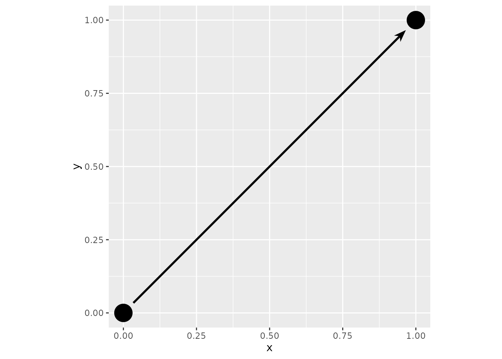

You can make your own arrowheads by supplying the `arrow_head` parameter
a 2-column matrix of polygon points. I’ll make a simple triangle:

``` r

triangle <- cbind(x = c(1, 0, 0), 
                  y = c(0, .5, -.5))

base_plot +
  geom_arrow(arrow_head = triangle)
```

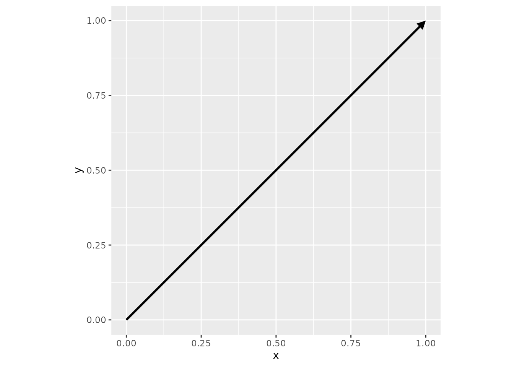

You can make any shape you want. I made arrowheadr to facilitate getting
complex shapes into the box that ggarrow functions expect.

The arrowheadr functions do not depend on ggarrow, but were designed to
be used with ggarrow. The main `arrow_head_*` functions return a matrix
with columns `x` and `y` to create a polygon fitting in a square from −1
to 1 on both the *x* and *y* axes.

The main `arrow_head_*` functions have an optional `plot` argument to
show what polygon will be used:

``` r

library(arrowheadr)
my_arrowhead <- arrow_head_deltoid(plot = TRUE)
```

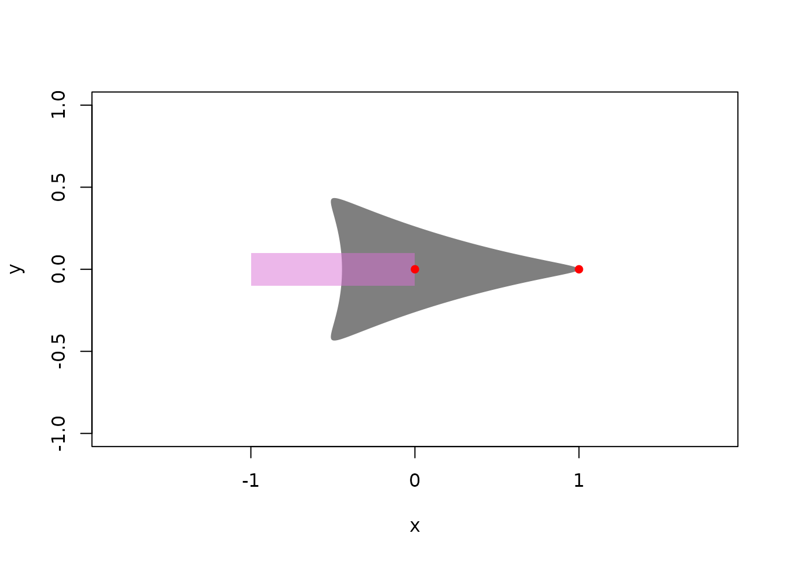

The pink rectangle shows where the arrow’s line will end. Typically, the
arrowhead’s point is expected to be at (1,0), but you can do anything
you want.

We can now use this output with ggarrow:

``` r

base_plot +
  geom_arrow(arrow_head = my_arrowhead)
```


## Examples with ggdiagram

I use ggarrow mostly for creating path diagrams with my
[ggdiagram](https://wjschne.github.io/ggdiagram/) package, which extends
ggplot2 capabilities to become more like [TikZ](https://tikz.dev/).

``` r

id <- c("A", "B", "C")


bp <- ggdiagram(font_family = "Roboto Condensed") +
  {latent <- ob_circle(
      center = ob_polar(theta = degree(c(210, 90, -30)), r = 3),
      label = ob_label(
        label = id,
        size = 60,
        nudge_y = -.09,
        fill = NA,
        color = "gray20"
      ),
      color = NA,
      fill = viridis::viridis(
        n = 3,
        begin = .2,
        end = .8,
        alpha = .5
      ),
      id = id
    )
  } 

myconnect <- redefault(connect, 
                       from = latent[c("A", "A", "B")],
                       to = latent[c("B", "C", "C")],
                       color = "gray20", 
                       resect = 2, 
                       linewidth = 1)
  
```

## Default Arrowhead from ggarrow

``` r

bp + myconnect(arrow_head = ggarrow::arrow_head_wings())
```


## Skinny Sharp Deltoid

``` r

bp + myconnect(arrow_head = arrow_head_deltoid(d = 2))
```


## Skinny Rounded Deltoid

``` r

bp + myconnect(arrow_head = arrow_head_deltoid(d = 2.7))
```


## Rounded spade

``` r

bp + myconnect(arrow_head = arrow_head_deltoid(d = 8))
```


## Sharp Barbs

Mimics the `latex'` arrowhead from
[tikz.arrows](https://tikz.dev/tikz-arrows)

``` r

bp + myconnect(arrow_head = arrow_head_latex())
```


Mimics the regular `latex` arrowhead from tikz.arrows

``` r

bp + myconnect(arrow_head = arrow_head_latex(undercontrols = NULL))
```


## Catenary Curve

A catenary curve looks like a parabola, but it describes the curve of a
hanging chain.

``` r

bp + myconnect(arrow_head = arrow_head_catenary())
```

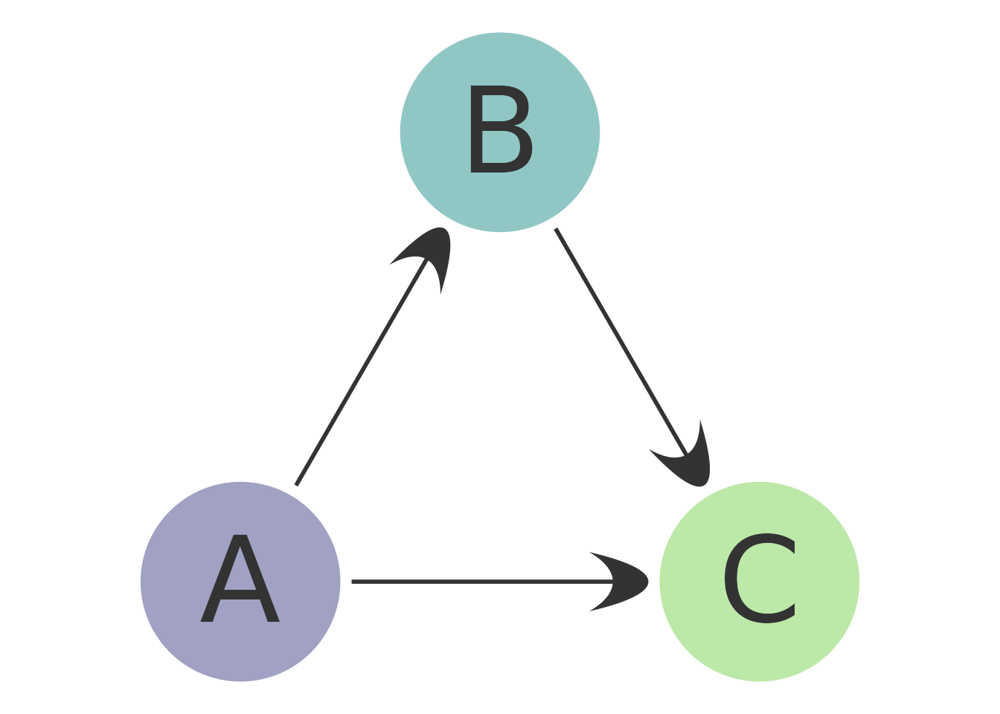

It is possible to play with the thickness at the top of the arch and the
width of the base.

``` r

bp + myconnect(arrow_head = arrow_head_catenary(
  thickness = .5, 
  base_width = .2, 
  rescale = c(1, .75)))
```

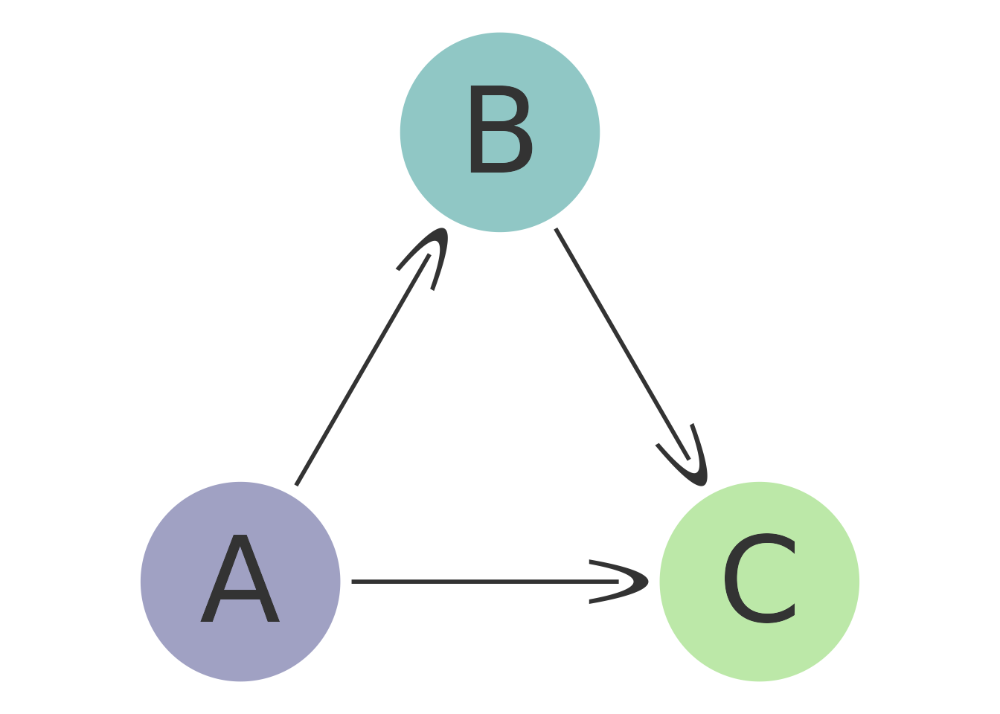

Figure 2

## Bezier Curves

A list of bezier control points can make almost any shape.

``` r

# A list of bezier curve control points
enterprise <- list(c(1, 0, 
                     .5, .3, 
                     0, .3),
                   c(0, .3, 
                     .80, -.125, 
                     .075, -.3),
                   c(.075, -.3, 
                     .5, -.3, 
                     1, 0)) |>
  arrow_head_bezier(plot = T)
```

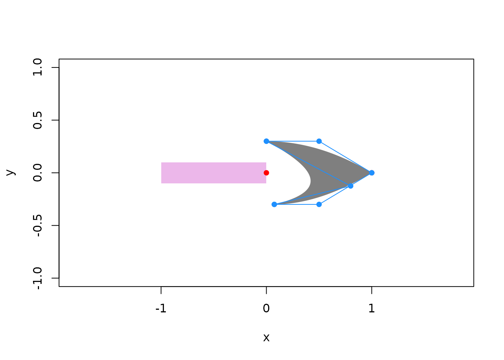

``` r


bp + myconnect(arrow_head = enterprise, length_head = 10, linewidth = 1.5)
```


## Arrowhead from an arbitrary function

You can make an arrowhead from any function you want. Here is the normal
probability density function:

``` r

bp + myconnect(arrow_head = arrow_head_function(dnorm))
```

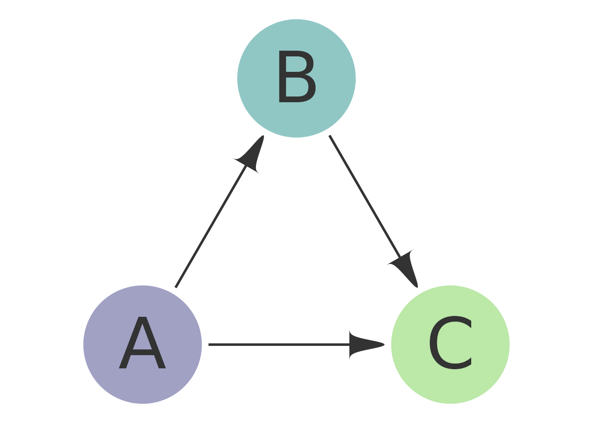

## Unitizing

The arrowheads (and fins) in the ggarrow package are expected to fit in
a square from $`[-1, +1]`$ in both directions. Sometimes we have data
that is well outside that square. The `unitizer` function makes sure all
the data in the matrix fits inside a unit circle (centered at 0 by
default).

For example, the shape in [Figure 3](#fig-unitizer1) will not display
properly as an arrowhead in ggarrow because its tip is at (3, 0) instead
of (1, 0).

``` r

theta <- seq(0, 2 * pi, length.out = 361)

d <- tibble(theta = theta,
       x = -sin(theta)  + 2 * sin(theta) ^ 2,
       y = cos(theta)) |> 
  select(x,y) 

d |> 
  ggplot(aes(x,y)) +
  geom_path() +
  coord_equal()
```

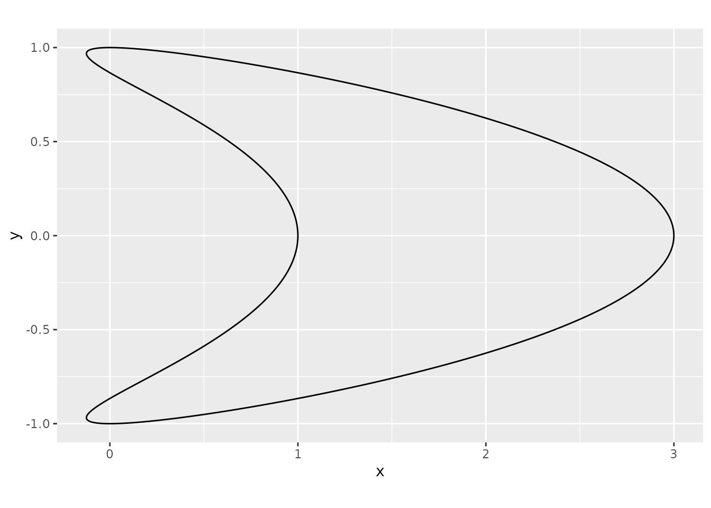

Figure 3

In [Figure 4](#fig-unitizer2), the shape from [Figure 3](#fig-unitizer1)
is rescaled so that the tip is at point (1, 0).

``` r

myarrow <- 
  d |> 
  as.matrix() |> 
  unitizer()

bp + myconnect(arrow_head = myarrow, linewidth = 1)
```

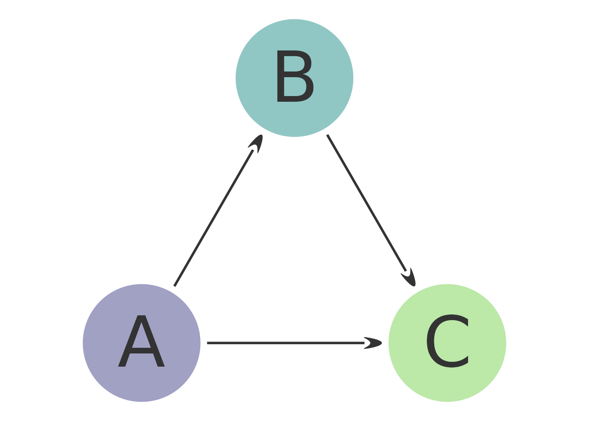

Figure 4

## Nudging

The arrowheads can be nudged in the x and y axes with a length 2 vector.
For example, the `arrow_head_harpoon` function by default is centered on
the line, which does not look good.

``` r


xy <- arrow_head_harpoon(plot = TRUE)
```

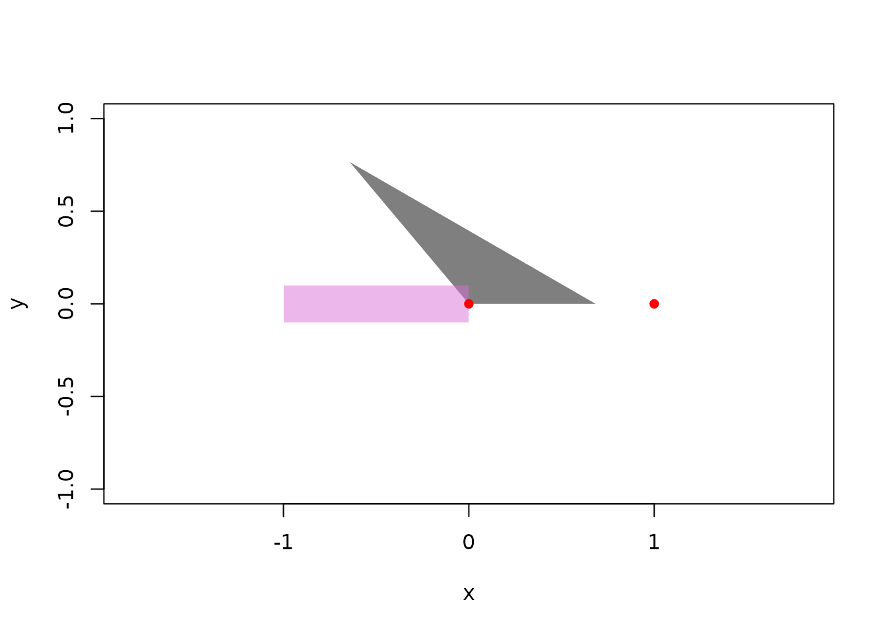

``` r


data.frame(x = c(0, 1), y = c(0, 1)) |>
  ggplot(aes(x, y)) +
  geom_arrow(arrow_head = xy, length_head = 10) +
  coord_equal()
```

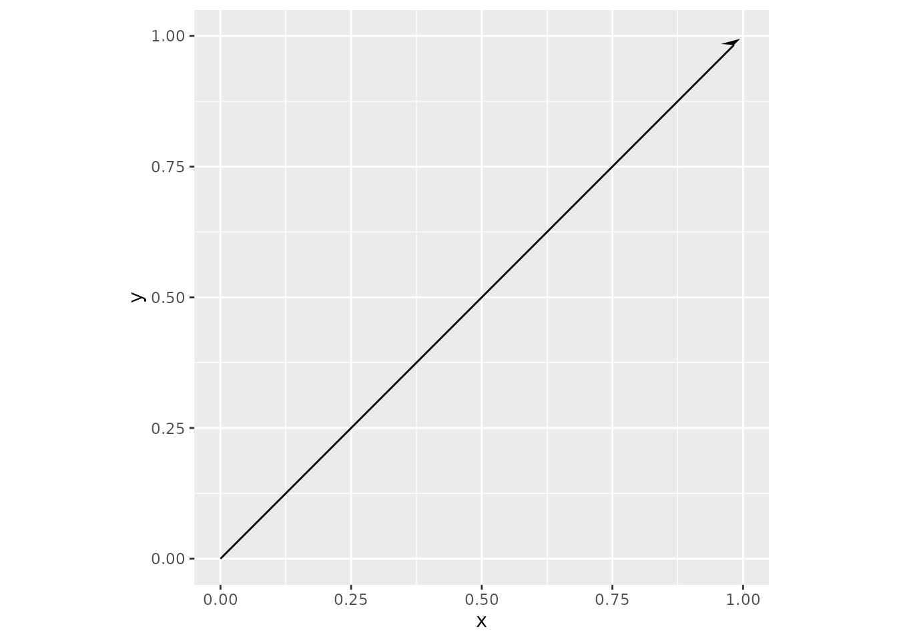

Depending on the `linewidth` and `length_head`, we can nudge the harpoon
downward so that it looks like a harpoon.

``` r


bp + myconnect(arrow_head = arrow_head_harpoon(nudge = c(0, -.06)), length_head = 12)
```


## Rescaling

The arrowheads can be rescaled like so:

``` r


xy <- arrow_head_latex(rescale = .6, plot = TRUE)
```

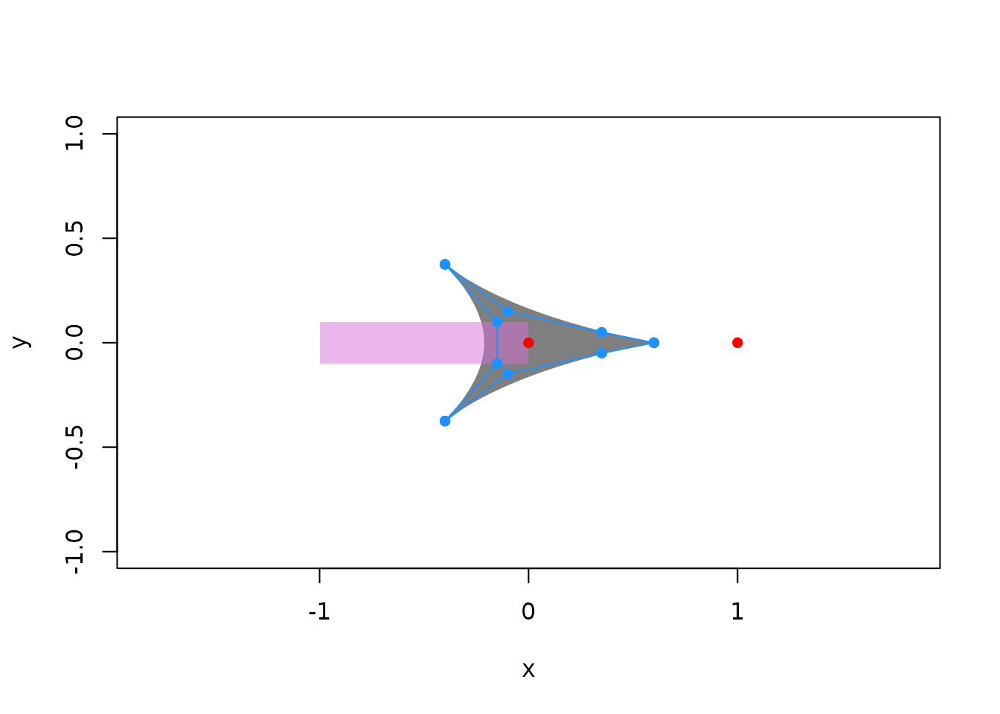

By combining rescaling with nudging, we can separate the arrowhead from
the line:

``` r


xy <- arrow_head_latex(rescale = .6,
                       nudge = c(.4, 0),
                       plot = TRUE)
```

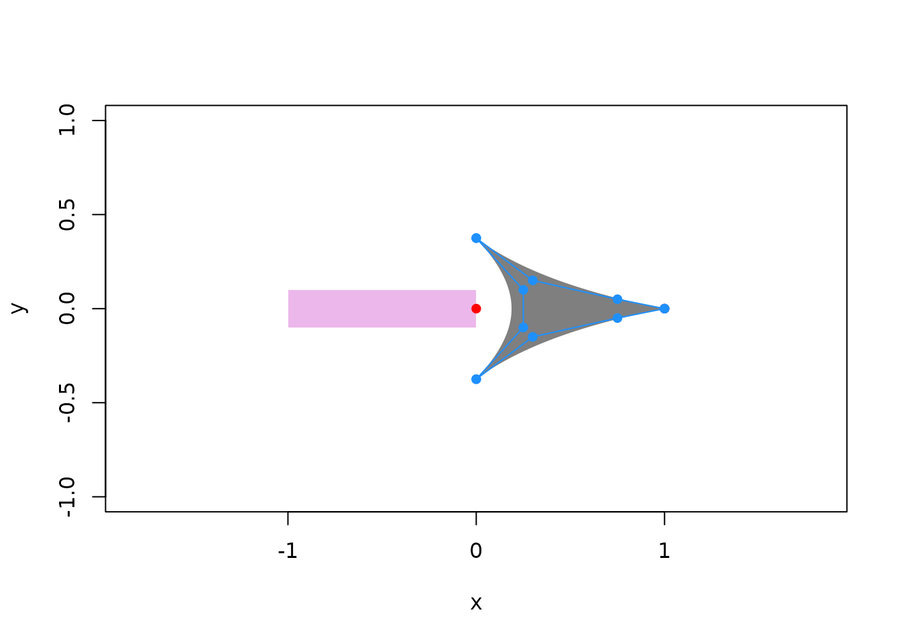

``` r

bp + myconnect(arrow_head = xy, length_head = 10)
```


The rescaling can be different on the x and y dimensions. Here we
decrease the width by half and increase the height by half.

``` r


xy <- arrow_head_latex(rescale = c(.5, 1.5), plot = TRUE)
```

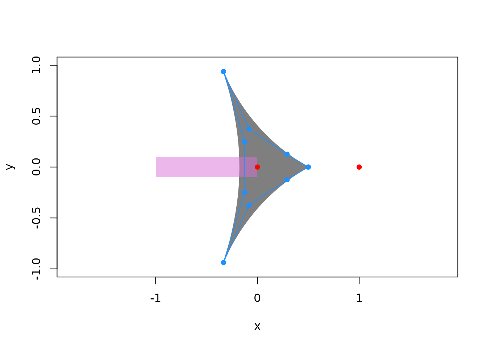

## Rotating

Here I put the rotated arrowhead into the head and fin of the arrow. The
rotation is in radians, not degrees.

``` r


xy <- arrow_head_latex(rotate = pi,
                       nudge = c(.4, 0),
                       plot = TRUE)
```

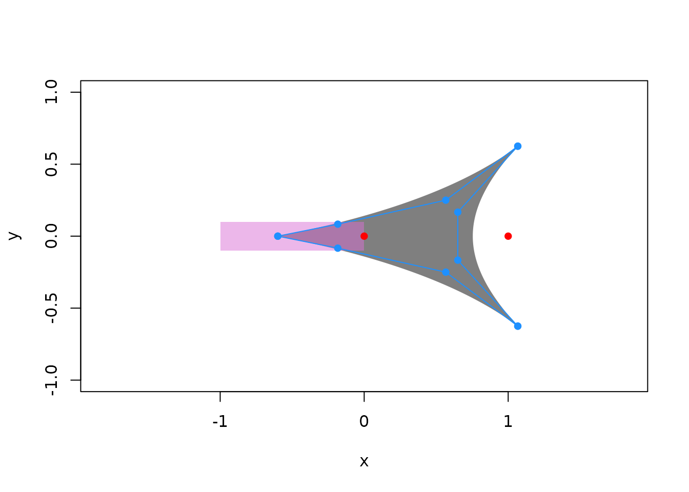

``` r


bp + myconnect(arrow_head = xy, arrow_fins = xy, resect = 3)
```


## Reflecter function

Because most arrowheads are symmetric, we can design one half of the
arrowhead and then duplicate the other half in reverse order. The
`reflector` function takes a matrix, reverses the sign of the y values,
and reorders the rows, and adds the reflected matrix to the original
matrix.

Here, I supply the bezier controls for just the top half of the arrow,
the `arrow_head_bezier` function creates the polygon points for the top
half, and the `reflecter` function adds the mirror image points below to
the polygon symmetric.

``` r

myarrow <- list(c(1.0, .00,
                  .65, .25,
                  .40, .37,
                  .00, .40),
                c(.00, .40,
                  .00, .00,
                 -1.0, .00),
               c(-1.0, .00)) |> 
  arrow_head_bezier() |> 
  reflecter()


bp + myconnect(arrow_head = myarrow, length_head = 5)
```


## Preset arrowheads

The `arrowheads` object is a list of static, pre-defined arrowheads that
I think are useful and/or fun. For example, [Figure 5](#fig-leaf) has a
classic “leaf” arrowhead.

``` r

bp + myconnect(arrow_head = arrowheads$leaf)
```


Figure 5

[Figure 6](#fig-icon) has the entire collection of arrowheads in the
`arrowheads` list object.

``` r

k <- length(arrowheads)
theta <- degree(seq(0, 360, length.out = k + 1)[-(k + 1)])

ggdiagram() + 
  connect(ob_point(),
          ob_polar(theta), 
          resect = 5,
          arrow_head = arrowheads,
          linewidth = 2
          ) + 
  ob_label(label = names(arrowheads),
           center = ob_polar(theta, r = 1.1),
           angle = 0,
           hjust = 0.5)
```

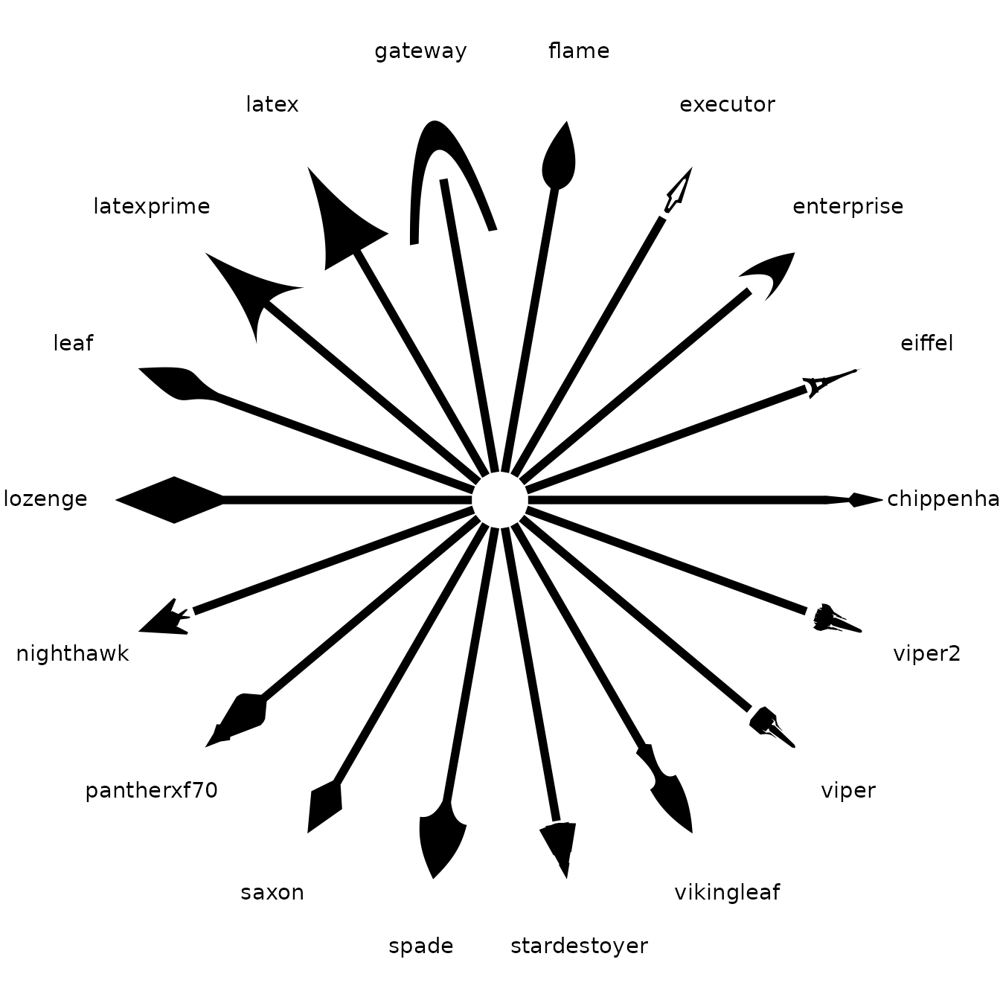

Figure 6: Arrowheads in the `arrowheads` collection
