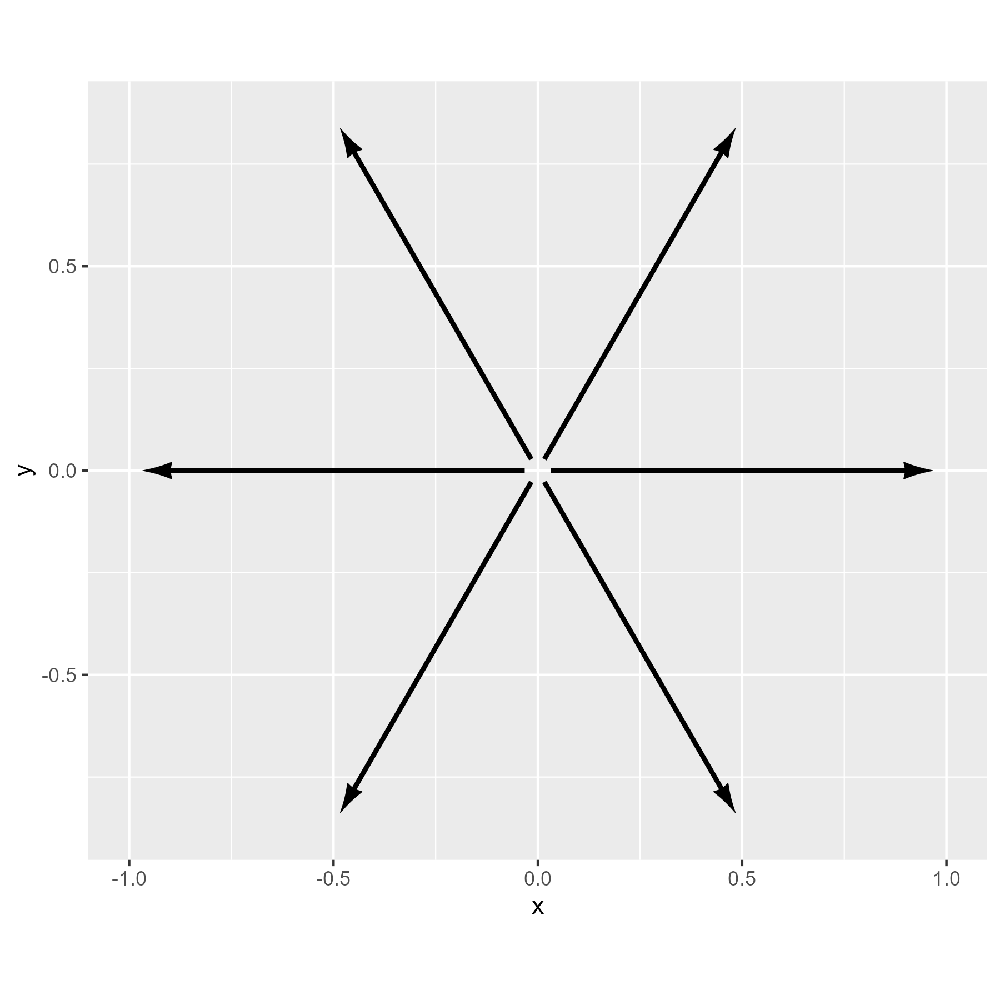
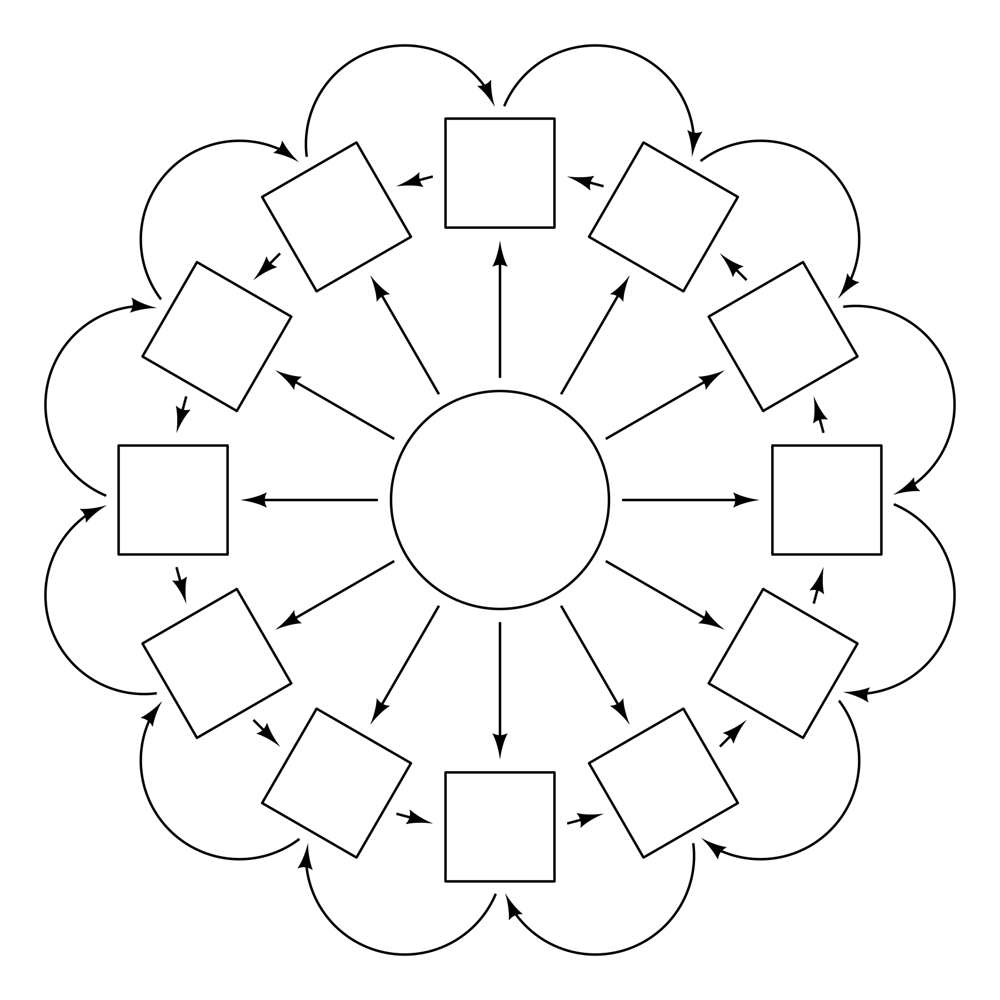

# arrowheadr

## Purpose

The arrowheadr package allows one to create custom arrowheads that can
be used with the [ggarrow](https://github.com/teunbrand/ggarrow)
package.

## Installation

The arrowheadr package can be installed via CRAN:

``` r

install.packages("arrowheadr")
```

The development version of arrowheadr can be installed by running this
code:

``` r

install.packages("arrowheadr", repos = c('https://wjschne.r-universe.dev'))
```

# Example

The ggarrow package makes it possible to create a wide variety of
arrows. The arrowheadr package makes it easy to create custom
arrowheads.

``` r

tibble(theta = seq(0,300, 60) * pi / 180,
           x = cos(theta),
           y = sin(theta)) |>
  ggplot(aes(x, y)) +
  coord_equal() + 
  geom_arrow_segment(aes(xend = x, yend = y, x = 0, y = 0), arrow_head = arrow_head_deltoid(), resect = 2)
```



The ggdiagram package also uses arrowheadr and ggarrow under the hood.

``` r

# Make a circle
A <- ob_circle(center = ob_point(0, 0),
                  radius = 1)

# Make angles evenly spaced around a circle
theta <- degree(seq(0,330, 30))

# Make ring of points around the circle
p <- ob_point() |> 
  place(from = A, 
        where = theta,
        sep = 2)

# Make rotated squares
B <- ob_rectangle(center = p, angle = theta)


ggdiagram() + 
  A + 
  B + 
  # Arrows from A to B
  connect(A, B, resect = 2) + 
  # Straight arrows from B to adjacent B
  connect(B@north, B[c(2:12, 1)]@south, resect = 2) + 
  # Arc arrows from B to adjacent B
  connect(B[c(2:12, 1)]@east, B@east, arc_bend = -1, resect = 2)
```


